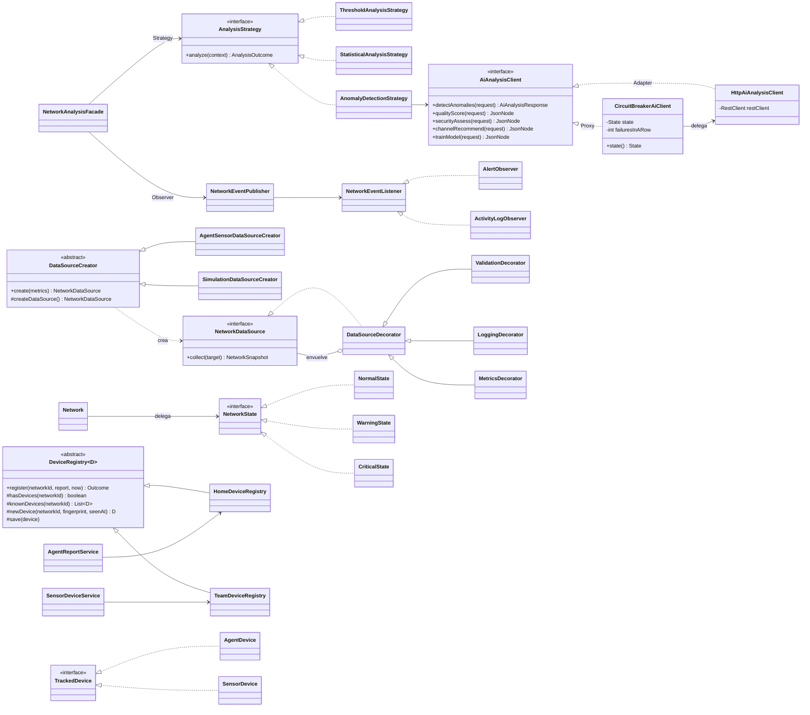

# Patrones de diseño en WiFiSense-backend

Cada patrón se adoptó porque resolvía un problema concreto. Los patrones que se analizaron y **no** se
implementaron también se explican al final, porque descartar un patrón innecesario es una decisión de diseño.

**Resumen (revisado contra el código en la auditoría del Avance 18, `docs/auditoria_final.md`):**

| # | Patrón | Tipo | Problema que resuelve | Prueba que lo demuestra |
|---|---|---|---|---|
| 1 | Factory Method | Creacional | Crear la fuente de datos correcta sin `switch` | `NetworkDataSourceProviderTest` |
| 2 | Decorator | Estructural | Validar, registrar y medir cada lectura sin tocar las fuentes | `DataSourceDecoratorTest` |
| 3 | Strategy | Comportamiento | Elegir el análisis (umbrales, estadístico o IA) en tiempo de ejecución | `ThresholdAnalysisStrategyTest`, `StatisticalAnalysisStrategyTest`, `AnomalyDetectionStrategyTest` |
| 4 | State | Comportamiento | Reglas de cada estado de salud de la red y sus transiciones | `NetworkStateTest` |
| 5 | Observer | Comportamiento | Reaccionar a un análisis (alertas, actividad) sin acoplar la fachada | `ObserverTest` |
| 6 | Facade | Estructural | Una sola llamada para todo el análisis | `NetworkAnalysisFacadeTest` |
| 7 | Adapter | Estructural | Usar la API REST de la IA y la de Brevo como interfaces Java | `HttpAiAnalysisClientTest`, `AiContractTest`, `BrevoEmailSenderTest` |
| 8 | Template Method (2 usos) | Comportamiento | Que ninguna fuente nueva se salte la validación; registrar los equipos de Mi Wi-Fi y del sensor con un solo algoritmo | `DataSourceCreatorTemplateTest`, `DeviceRegistryTest` |
| 9 | Proxy (Circuit Breaker) | Estructural + resiliencia | Que la IA caída no deje esperando 10 s cada llamada | `CircuitBreakerAiClientTest` |

En los otros repositorios: **Null Object**, Strategy y Pipeline en la IA
([WiFiSense-ai/docs/patrones.md](https://github.com/davidcampino06/Patrones_WiFi_-Artificial_Intelligence/blob/main/docs/patrones.md))
y **Error Boundary**, Provider, Custom Hook y Single-flight en la página
([WiFiSense-frontend/docs/patrones.md](https://github.com/davidcampino06/Patrones_WiFi_Froned/blob/main/docs/patrones.md)).

```text
Controller / MonitoringJob / SensorReportService ──► NetworkAnalysisFacade (Facade)
                   │
                   ├── AnalysisStrategy (Strategy) ── AnomalyDetectionStrategy ── AiAnalysisClient
                   │                                                    └── CircuitBreakerAiClient (Proxy) ──► HttpAiAnalysisClient (Adapter) ──► WiFiSense-ai
                   ├── MeasurementCollectionService
                   │        └── NetworkDataSourceProvider ── DataSourceCreator (Factory Method + Template Method)
                   │                                              └── Metrics → Logging → Validation → fuente concreta (Decorator)
                   ├── Network.applyDetectedStatus() ── NetworkState (State)
                   └── NetworkEventPublisher (Observer) ── AlertObserver, ActivityLogObserver
```

### Diagrama de clases



---

## 1. Factory Method

**Problem.** Los datos de una red pueden venir de simulación, del propio servidor, de la API de un router, de SNMP
o de una captura de tráfico. Si el servicio de recolección hiciera `new SimulationDataSource(...)` o un `switch`
por tipo, cada fuente nueva obligaría a modificarlo, y cada fuente tiene dependencias distintas para construirse.

**Solution.** `DataSourceCreator` declara el método de fábrica `createDataSource()`. Cada creador concreto decide
qué producto construir y con qué dependencias. La operación `create()` del creador (final) usa el método de fábrica
y aplica a cualquier producto la misma cadena de decoradores.

**Classes.**
- Creator: `DataSourceCreator`
- Concrete creators: `AgentSensorDataSourceCreator`, `SimulationDataSourceCreator`, `SystemDataSourceCreator`,
  `RouterApiDataSourceCreator`, `SnmpDataSourceCreator`, `TrafficCaptureDataSourceCreator`
- Product: `NetworkDataSource`
- Concrete products: `AgentSensorDataSource`, `SimulationDataSource`, `SystemDataSource`, `RouterApiDataSource`,
  `SnmpDataSource`, `TrafficCaptureDataSource`
- Cliente: `NetworkDataSourceProvider` (elige el creador por `DataSourceType` con un `EnumMap`)

**Where.** `com.wifisense.network`

**Benefit.** Agregar una fuente = una clase producto + una clase creadora anotada con `@Component`. No se modifica
ninguna clase existente (OCP). `MeasurementCollectionService` solo conoce la interfaz `NetworkDataSource` (DIP).

**Ejemplo de ejecución.** El monitoreo pide la fuente de una red con `NetworkDataSourceProvider.forType(SYSTEM)`: el
proveedor busca `SystemDataSourceCreator` en su `EnumMap`, llama a `create()` y devuelve una `SystemDataSource` ya
decorada; la segunda vez devuelve la misma instancia (`NetworkDataSourceProviderTest.reusesTheSameInstancePerType`).

**Why.** Es el patrón que separa *qué* fuente usar de *cómo* construirla. Un `switch` simple funcionaría hoy, pero
el proyecto ya prevé cinco fuentes con dependencias distintas.

**Estado real.** `SimulationDataSource` está completa. `SystemDataSource` es real pero parcial (mide latencia,
jitter y pérdida hacia un host de prueba; no puede medir señal ni ancho de banda). Router API, SNMP y captura de
tráfico están preparadas y lanzan `DataSourceUnavailableException` con un mensaje claro (parte del 20 % pendiente).
`AgentSensorDataSource` es la fuente de las redes del equipo: no se consulta, el sensor (el agente WiFiSense) envía
sus mediciones; por eso su `collect()` explica que la red la mide su sensor y el monitoreo programado no la recorre
(`DataSourcePolicy.collectsAutomatically`). Simulación y sistema solo se pueden elegir con `DEMO_DATA_SOURCES=true`.

---

## 2. Decorator

**Problem.** Toda lectura debe validarse, registrarse en logs y medirse (tiempo y fallos). Ponerlo dentro de cada
fuente duplicaría código cinco veces y mezclaría responsabilidades; la herencia no sirve porque las combinaciones
crecen (`LoggedValidatedSimulationDataSource`…).

**Solution.** Decoradores que implementan `NetworkDataSource`, envuelven otra fuente y añaden una sola
responsabilidad cada uno. La cadena se arma una vez en `DataSourceCreator.create()`:
`MetricsDecorator → LoggingDecorator → ValidationDecorator → fuente concreta`.

**Classes.**
- Component: `NetworkDataSource`
- Concrete components: las seis fuentes
- Decorator: `DataSourceDecorator` (abstracto, delega por defecto)
- Concrete decorators: `ValidationDecorator`, `LoggingDecorator`, `MetricsDecorator`

**Where.** `com.wifisense.network.decorator`

**Benefit.** `SimulationDataSource` no se modificó para obtener validación, logs ni métricas (OCP, SRP). Las
métricas se exponen en `GET /api/observability/data-sources` y se ven en el panel del frontend.

**Ejemplo de ejecución.** Una lectura con 140 % de pérdida entra a `MetricsDecorator`, pasa por `LoggingDecorator` y
`ValidationDecorator` la rechaza con `InvalidSnapshotException` ("pérdida de paquetes"); `MetricsDecorator` cuenta
el fallo (`DataSourceDecoratorTest`).

**Why.** Es la forma de añadir comportamiento transversal a objetos que comparten interfaz sin tocarlos. El orden
importa: métricas va por fuera para contar también los fallos de validación.

---

## 3. Strategy

**Problem.** Hay varias formas de juzgar la salud de una red: límites fijos, desviación estadística respecto al
propio historial y un modelo de IA. Un método con `if (type == ...)` crecería con cada técnica nueva.

**Solution.** Interfaz `AnalysisStrategy` con `analyze(AnalysisContext)`. La fachada recibe todas las estrategias
por inyección y las indexa en un `EnumMap<AnalysisType, AnalysisStrategy>`; el usuario elige el tipo en tiempo de
ejecución.

**Classes.** `AnalysisStrategy`, `ThresholdAnalysisStrategy`, `StatisticalAnalysisStrategy`,
`AnomalyDetectionStrategy`, `AnalysisContext`, `AnalysisOutcome`

**Where.** `com.wifisense.analysis`

**Benefit.** Una estrategia nueva es una clase nueva; la fachada no cambia (OCP). Las tres son intercambiables a
través de la interfaz (LSP). El monitoreo automático usa `THRESHOLD` (barato) y el analista puede pedir `ANOMALY_DETECTION`.

**Ejemplo de ejecución.** `POST /api/networks/3/analyses {"type":"ANOMALY_DETECTION"}`: la fachada toma del
`EnumMap` la `AnomalyDetectionStrategy`, que envía la ventana a la IA y devuelve el estado y la predicción; con
`{"type":"THRESHOLD"}` la misma llamada usa los límites fijos sin tocar la IA.

**Why.** Encapsula algoritmos intercambiables con la misma entrada y salida, que es exactamente el caso.

---

## 4. State

**Problem.** El comportamiento de una red depende de su salud: cada cuánto se monitorea, qué severidad tiene la
alerta al entrar en un estado, si se cierran las alertas abiertas y cómo se transiciona. Con `if (status == CRITICAL)`
repartidos por el código, cambiar una regla obliga a buscar todos los sitios.

**Solution.** Cada estado es un objeto que implementa `NetworkState`. `Network` guarda el `NetworkStatus` (columna
`status`) y delega en `NetworkState.of(status)`.

| Estado | Intervalo de recolección | Alerta al entrar | Cierra alertas | Transición especial |
|---|---|---|---|---|
| `NormalState` | 5 min | INFO (recuperación) | Sí | — |
| `WarningState` | 2 min | WARNING | No | — |
| `CriticalState` | 1 min | CRITICAL | No | Una lectura NORMAL lo lleva a WARNING, no a NORMAL |

**Classes.** `NetworkState`, `NormalState`, `WarningState`, `CriticalState`, `Network`

**Where.** `com.wifisense.network.state`, `Network.applyDetectedStatus()`, `Network.isCollectionDue()`

**Benefit.** Las reglas de cada estado están en un solo archivo. `MonitoringJob` y `AlertObserver` piden al estado
lo que necesitan sin preguntar cuál es.

**Ejemplo de ejecución.** Una red en `CRITICAL` recibe un análisis `NORMAL`: `CriticalState` la pasa a `WARNING`
(no a `NORMAL`), y solo el siguiente análisis normal la recupera y cierra sus alertas
(`NetworkStateTest.criticalNetworkRecoversThroughWarning`).

**Why.** Las transiciones con histéresis (recuperarse pasando por WARNING) son comportamiento propio del estado.

---

## 5. Observer

**Problem.** Tras un análisis pasan varias cosas: crear alertas, cerrar alertas, registrar actividad. Si la fachada
llamara a cada servicio, quedaría acoplada a todos y crecería con cada reacción nueva.

**Solution.** `NetworkEventPublisher` (sujeto) notifica a todos los `NetworkEventListener` (observadores) inyectados
por Spring. Los eventos son records de una jerarquía sellada: `MeasurementCollectedEvent`, `AnalysisCompletedEvent`,
`NetworkStatusChangedEvent`.

**Classes.** `NetworkEventPublisher`, `NetworkEventListener`, `AlertObserver`, `ActivityLogObserver`, `NetworkEvent`

**Where.** `com.wifisense.event`

**Benefit.** Un observador nuevo (por ejemplo, notificación por correo) es una clase nueva. La publicación es
síncrona y dentro de la misma transacción, así que una alerta nunca queda guardada sin su análisis.

**Ejemplo de ejecución.** Un análisis lleva la red de `NORMAL` a `CRITICAL`: la fachada publica
`NetworkStatusChangedEvent`; `AlertObserver` abre una alerta crítica y `ActivityLogObserver` lo anota en la actividad
reciente, sin que la fachada sepa que existen (`ObserverTest`).

**Why.** Un evento, varias reacciones independientes. Se descartó un `AnalysisObserver` que lanzara análisis al
recibir mediciones: crearía una dependencia circular (fachada → publicador → observador → fachada). El
`MonitoringJob` orquesta recolección y análisis de forma explícita, que es más fácil de seguir.

---

## 6. Facade

**Problem.** Analizar una red implica: buscar la red, leer la ventana de mediciones, recolectar si no hay datos,
cruzar tráfico, ejecutar la estrategia, guardar resultado y predicción, actualizar el estado y publicar eventos.
El controlador no debería conocer nada de eso.

**Solution.** `NetworkAnalysisFacade.analyze(networkId, type, requestedBy)` coordina el subsistema completo. Desde el
Avance 18 lo hace en dos transacciones cortas con la estrategia en medio: la detección con IA puede esperar varios
segundos y una conexión a la base no debe quedar ocupada mientras tanto (`theStrategyRunsOutsideAnyTransaction…`).

**Classes.** `NetworkAnalysisFacade` y los subsistemas que coordina (repositorios, `MeasurementCollectionService`,
estrategias, `NetworkEventPublisher`).

**Where.** `com.wifisense.analysis.NetworkAnalysisFacade`; la usan `AnalysisController`, `MonitoringJob` y
`SensorReportService` (análisis por umbrales después de cada reporte del sensor).

**Benefit.** Tres clientes distintos (REST, tarea programada y reporte del sensor) ejecutan exactamente el mismo flujo
con una llamada.

**Ejemplo de ejecución.** El sensor de «Lab-Redes» envía un reporte: `SensorReportService` guarda la medición y llama
a `analyze(3, THRESHOLD, null)`; la fachada lee la ventana, aplica la estrategia, guarda el resultado, actualiza el
estado y publica los eventos (`NetworkAnalysisFacadeTest.storesResultUpdatesStateAndPublishesStatusChange`).

**Why.** Simplifica una operación compleja sin ocultar el subsistema a quien sí lo necesite.

---

## 7. Adapter

**Problem.** El backend necesita dos servicios externos con interfaces ajenas: la IA (una API REST en Python con sus
rutas, su cabecera `X-API-Key`, JSON en camelCase y códigos HTTP) y Brevo (la API HTTP de correo, con su propio
formato). Si los servicios del dominio hicieran las llamadas HTTP, cada uno conocería URLs, cabeceras y errores HTTP,
y cambiar de proveedor obligaría a tocarlos todos.

**Solution.** Una interfaz propia del dominio (*target*) y una clase que la implementa traduciendo cada método a la
API externa (*adaptee*): `HttpAiAnalysisClient implements AiAnalysisClient` convierte `detectAnomalies(request)` en
`POST /api/v1/anomalies/detect` con la clave, y cualquier error HTTP o de red en `AiServiceUnavailableException`;
`BrevoEmailSender implements EmailSender` convierte `send(EmailMessage)` en la llamada a la API de Brevo.

**Classes.** Target: `AiAnalysisClient`, `EmailSender` · Adapters: `HttpAiAnalysisClient`, `BrevoEmailSender` ·
Adaptees: la API REST de WiFiSense-ai y la API HTTP de Brevo.

**Where.** `com.wifisense.analysis.HttpAiAnalysisClient`, `com.wifisense.mail.BrevoEmailSender`

**Benefit.** `AgentInsights`, `AnomalyDetectionStrategy`, `AiTrainingService` y los demás no saben que existe HTTP:
en las pruebas se reemplazan por un mock de la interfaz. Las **pruebas de contrato** (`AiContractTest` aquí y
`tests/test_contract.py` en la IA, con los mismos JSON de ejemplo) aseguran que el adaptador y la API real siguen
hablando el mismo idioma.

**Ejemplo de ejecución.** `AgentInsights.assessSecurity(report)` llama a `securityAssess(new AiSecurityRequest(...))`;
el adaptador hace `POST /api/v1/security/assess` con `{"authentication":"WPA2","openPorts":[23,53,80],…}` y devuelve
el JSON de la auditoría (`AiContractTest.theSecurityAuditIsAskedAsTheAiExpectsAndItsAnswerIsAccepted`).

**Corrección de la auditoría.** Hasta el Avance 17 este documento decía que Adapter "no estaba implementado"; ya lo
estaba en estas dos clases, solo que no se había documentado.

---

## 8. Template Method

**Problem.** Cada fuente de datos nueva debe pasar siempre por validación, logs y métricas, en ese orden. Si cada
creador armara su propia cadena, uno nuevo podría olvidar la validación y guardar lecturas imposibles.

**Solution.** `DataSourceCreator.create()` es el método plantilla: es `final` y fija el algoritmo (crear el producto
y envolverlo en `Validation → Logging → Metrics`); el único paso que cambia cada subclase es `createDataSource()`.
Es la forma en que GoF describe la relación entre Factory Method y Template Method.

**Classes.** `DataSourceCreator` (plantilla), los seis creadores concretos (paso variable).

**Where.** `com.wifisense.network.DataSourceCreator`

**Benefit.** Un creador nuevo no puede saltarse la validación ni cambiar el orden de los decoradores: el compilador
no deja sobrescribir `create()`.

**Ejemplo de ejecución.** Un creador de prueba que no valida nada devuelve una lectura con 140 % de pérdida: aun así
`create()` la envuelve, la validación la rechaza y las métricas cuentan el fallo (`DataSourceCreatorTemplateTest`).

### Segundo uso: registrar los equipos de un reporte (`DeviceRegistry`)

**Problem.** Mi Wi-Fi (`AgentReportService`) y el sensor de las redes del equipo (`SensorDeviceService`) tenían el
mismo ciclo copiado: equipo nuevo o conocido, fabricante, nombre, tipo, MAC privada, equipo no autorizado que sigue
conectado y periodos de conexión. En el Avance 16 (tipo de equipo) hubo que cambiar las dos copias; un cambio en
una sola habría hecho que la casa y la sede contaran distinto los equipos nuevos.

**Solution.** `DeviceRegistry.register()` es el método plantilla (`final`): recorre el reporte y aplica las reglas
en el mismo orden para todos. Las subclases solo dicen dónde viven sus equipos: `HomeDeviceRegistry`
(`agent_devices`) y `TeamDeviceRegistry` (`network_sensor_devices`). Las dos entidades implementan `TrackedDevice`,
la interfaz con lo que el algoritmo necesita de un equipo.

**Classes.** Plantilla: `DeviceRegistry<D extends TrackedDevice>` · pasos concretos: `HomeDeviceRegistry`,
`TeamDeviceRegistry` · producto: `AgentDevice`, `SensorDevice` (`TrackedDevice`).

**Where.** `com.wifisense.service.DeviceRegistry`, `com.wifisense.model.TrackedDevice`

**Benefit.** Una regla nueva de los equipos se escribe una vez y vale para la casa y para la sede; se quitaron unas
70 líneas repetidas. Los servicios conservan su constructor: cada uno crea su registro con sus repositorios.

**Ejemplo de ejecución.** El primer reporte de una red solo aprende sus equipos (0 nuevos, para no alertar de todos);
el siguiente trae un Chromecast: 1 nuevo, con su nombre «Sala TV», tipo TV y modelo; un equipo marcado como no
autorizado que sigue conectado se cuenta, y los equipos se guardan antes de sus periodos de conexión
(`DeviceRegistryTest`, con un registro en memoria y con los dos registros reales).

---

## 9. Proxy (con Circuit Breaker)

**Problem.** Cuando la IA no responde (Railway la redespliega o está arrancando) cada llamada espera el tiempo máximo
de 10 s. Un reporte del sensor pide a la IA hasta cuatro veredictos: podía tardar hasta 40 s, el agente (que espera
30 s) lo daba por perdido y el backend tenía un hilo ocupado por cada reporte. El análisis con IA, además, esperaba
dentro de una transacción.

**Solution.** `CircuitBreakerAiClient` es un **proxy de protección**: implementa la misma interfaz `AiAnalysisClient`,
es el que Spring inyecta (`@Primary`) y controla el acceso al objeto real (`HttpAiAnalysisClient`) con el patrón
**Circuit Breaker** (Microsoft, *Cloud Design Patterns*):

| Estado | Qué hace |
|---|---|
| Cerrado | Todas las llamadas van a la IA; cuenta las fallas seguidas por no responder |
| Abierto (después de 2 fallas seguidas) | Durante 30 s responde "IA no disponible" al instante, sin llamar |
| Medio abierto (pasados los 30 s) | Deja pasar **una** llamada de prueba: si funciona se cierra; si no, vuelve a abrirse |

Un 4xx (la IA respondió pero rechazó la solicitud) no cuenta como falla: la IA está disponible. El chequeo de salud
siempre pregunta a la IA, para que el panel de estado muestre la verdad. Se configura con
`wifisense.ai.circuit.failures` y `wifisense.ai.circuit.open-for`.

**Classes.** Subject: `AiAnalysisClient` · Proxy: `CircuitBreakerAiClient` · Real subject: `HttpAiAnalysisClient`.

**Where.** `com.wifisense.analysis.CircuitBreakerAiClient`

**Benefit.** Ningún servicio cambió: todos ya manejaban `AiServiceUnavailableException` (el reporte se guarda sin
veredictos, el análisis responde 503); ahora la reciben al instante en vez de después de 10 s. Con la IA caída, el
primer reporte tarda como mucho 20 s y los siguientes no esperan nada.

**Ejemplo de ejecución.** La IA deja de responder: dos llamadas fallan por tiempo y el circuito se abre; la tercera
(`securityAssess`) falla al instante con "se volverá a probar en 30 s" sin llegar a la IA. A los 30 s una llamada de
prueba encuentra la IA de nuevo y el circuito se cierra (`CircuitBreakerAiClientTest`).

**Por qué es Proxy y no Decorator.** El Decorator del proyecto agrega comportamiento a lo que devuelve la fuente
(validar, medir). Este objeto no cambia ninguna respuesta: decide **si** se llega al objeto real, que es la
intención del Proxy de protección.

---

## Patrones analizados y no implementados

Investigación de la auditoría del Avance 18: se revisó cada patrón contra un problema real del código. Se
implementaron los que resolvían uno: Proxy con Circuit Breaker, el segundo uso de Template Method (equipos), Null
Object (IA) y Error Boundary (página); Adapter ya existía. Fuentes: *Design Patterns* (Gamma y otros), *Cloud Design
Patterns* de Microsoft (Circuit Breaker, Bulkhead, Retry) y la documentación de React (Error Boundaries).

| Patrón | Decisión | Motivo |
|---|---|---|
| Builder | No | Los objetos con muchos campos son `record` inmutables o entidades con fábricas estáticas (`Measurement.from`). Un builder añadiría clases sin resolver nada. |
| Proxy de caché | No | Cada análisis usa datos nuevos; la descripción del modelo se pide pocas veces. El Proxy que sí se usa es el de protección (sección 9). |
| Command | No | Las acciones (reconocer o resolver alerta) son métodos de dominio simples; no hay deshacer ni cola de comandos. |
| Composite | No | Ubicación → zona → red es una jerarquía fija de tres niveles modelada con relaciones; no se necesita tratar hojas y grupos de forma uniforme. |
| Singleton | No (lo hace Spring) | Cada servicio ya es un único objeto administrado por Spring; un Singleton escrito a mano impediría reemplazarlo en las pruebas. |
| Chain of Responsibility | No (lo hace Spring) | Los filtros de cada petición (CORS, JWT, tamaño máximo con `RequestSizeLimitFilter`) ya forman la cadena de Spring Security. |
| Abstract Factory | No | Hay una sola familia de productos (fuentes de datos); Factory Method basta. |
| Mediator | No | La fachada ya coordina el análisis; no hay objetos que se hablen entre sí de muchas formas. |
| Retry (reintentos) | No | Reintentar una IA caída multiplica la espera; el Circuit Breaker hace lo contrario: deja de insistir un tiempo. El agente ya reintenta en su siguiente ciclo. |
| Bulkhead (limitar llamadas simultáneas a la IA) | No, por ahora | Separaría un grupo de hilos para la IA, para que una IA lenta no ocupe todos los del backend. La prueba de carga midió unas 70 peticiones por segundo de capacidad de la IA y el uso real es de 3 cuentas y sensores cada 5 minutos (menos de 1 por segundo); la IA caída ya la cubre el Circuit Breaker. Se implementaría si los sensores pasaran de unos cientos. |
| Rate Limiter | Ya existe | `LoginAttemptService`, `RegistrationThrottle`, `RecoveryThrottle`, `AgentReportThrottle` y `SpeedTestThrottle` limitan intentos por usuario, dirección o clave en una ventana de tiempo. |
| Outbox / guardar y reenviar en el agente | No | Una medición vale por el momento en que se toma, el análisis y el historial de conexiones usan la hora de llegada, y el backend acepta un reporte cada 50 s por clave: reenviar los atrasados en ráfaga no cabe. |
| Visitor, Memento | No | No hay una estructura de objetos que recorrer con operaciones nuevas ni estados que deshacer. |

### Patrones de arquitectura que también se usan

- **Repository** (Spring Data JPA): `*Repository` aísla las consultas; las de rendimiento usan SQL nativo
  (`MeasurementStatsRepository`).
- **DTO**: los `record` de `com.wifisense.dto` separan lo que viaja por HTTP de las entidades.
- **Capas**: controlador → servicio → repositorio; los controladores no tocan entidades ni SQL.
- En la página, **Custom Hook** (`useApi`) y un único punto de salida HTTP (`apiClient`); en la IA, el
  recomendador opcional (`ClaudeAdvisor`) con respaldo en reglas cuando Claude no está disponible.

## Estructuras de datos usadas (y por qué)

| Estructura | Dónde | Necesidad real |
|---|---|---|
| `List` | Ventana de mediciones (`AnalysisContext`), historial | Orden cronológico |
| `EnumMap` | Estrategias por tipo, creadores por fuente, redes por estado | Búsqueda O(1) por enum |
| `HashMap` | Tráfico por timestamp en `AnomalyDetectionStrategy`, predicciones por análisis | Unir dos consultas sin N+1 |
| `ConcurrentHashMap` | `DataSourceMetrics`, instancias de fuentes | Acceso concurrente (peticiones + tarea programada) |
| `ArrayDeque` (cola FIFO acotada) | `ActivityLogObserver` | Conservar solo los 100 eventos más recientes |
| `LinkedHashSet` | `ReportService.compare` | Quitar redes repetidas conservando el orden |
| `TreeMap` | Desviaciones en `StatisticalAnalysisStrategy`, errores de validación | Salida ordenada y estable |

No se usaron Stack, Tree ni Graph porque ningún problema actual los requiere. Un grafo de topología de
dispositivos queda como mejora futura cuando exista una fuente que descubra enlaces entre equipos.
