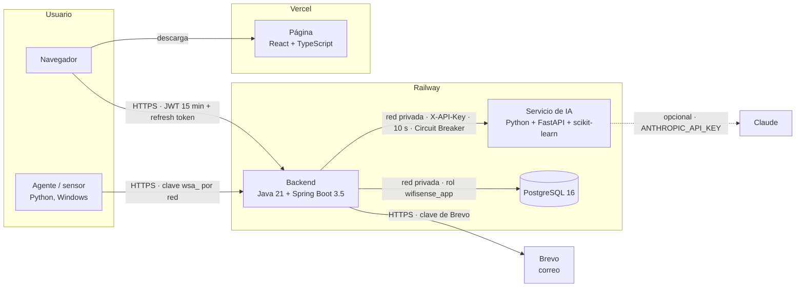

# Arquitectura de WiFiSense

Cuatro repositorios, cuatro componentes desplegados por separado. Esta página resume cómo se comunican, qué protege
cada conexión y qué variables necesita cada uno (sin valores: los secretos solo viven en Railway y Vercel).

## Componentes y comunicación

| De → a | Protocolo y autenticación | Límites | Si el destino falla |
|---|---|---|---|
| Navegador → backend | HTTPS, JWT de 15 min y refresh token de un solo uso; contraseña cifrada con RSA-OAEP | 16 KB por solicitud; bloqueo tras 5 intentos fallidos | La página muestra el error en español |
| Agente → backend | HTTPS, clave de 256 bits por red (`X-Agent-Key`), solo SHA-256 en la base | 1 reporte cada 50 s por clave; 128 KB por reporte | El agente reintenta en su siguiente ciclo y respeta `Retry-After` |
| Backend → IA | Red privada de Railway, `X-API-Key`; la IA no arranca en Railway sin clave | 10 s por llamada (2 min para entrenar); 8 MB por solicitud | Proxy con Circuit Breaker: tras 2 fallas seguidas responde "IA no disponible" al instante durante 30 s; el reporte se guarda sin veredictos y el análisis responde 503 |
| Backend → PostgreSQL | Red privada, rol `wifisense_app` sin permisos de esquema | 10 conexiones; consultas cortadas a los 30 s; la llamada a la IA nunca ocupa una conexión | El backend responde 503 y lo registra |
| Backend → Brevo | HTTPS, clave de Brevo | Envío en segundo plano | La respuesta al usuario es la misma; el fallo queda en el log |
| IA → Claude | HTTPS, `ANTHROPIC_API_KEY` (opcional) | 20 s, 1 reintento | Se usan las recomendaciones por reglas |

Reglas que se cumplen en el código: el navegador **solo** habla con el backend (lo prueba `tests/security.test.ts` de
la página), la IA no toca la base de datos (recibe los datos del backend) y ningún secreto está en los repositorios.

## Variables de entorno (sin valores)

| Componente | Variable | Para qué |
|---|---|---|
| Página (Vercel) | `VITE_API_URL` | URL pública del backend; el build de Vercel se detiene si falta |
| Backend (Railway) | `DATABASE_URL`, `DATABASE_USERNAME`, `DATABASE_PASSWORD` | PostgreSQL por la red privada, con `wifisense_app` |
| | `JWT_SECRET` | Firma de los tokens (32+ caracteres aleatorios) |
| | `AI_SERVICE_URL`, `AI_API_KEY` | Servicio de IA por la red privada y la clave compartida |
| | `CORS_ALLOWED_ORIGINS` | La URL de Vercel |
| | `ADMIN_USERNAME`, `ADMIN_PASSWORD` | Cuenta de administrador |
| | `BREVO_API_KEY`, `MAIL_FROM`, `FRONTEND_URL` | Correo de recuperación |
| | Opcionales: `PLAIN_PASSWORDS_ALLOWED`, `JWT_TTL`, `SESSION_REFRESH_TTL`, `MONITORING_RETENTION`, `DATABASE_POOL_SIZE`, `AI_TRAINING_AUTOMATIC` | Valores por defecto en `application.yml` |
| Servicio de IA (Railway) | `AI_API_KEY` | Obligatoria en Railway; igual a la del backend |
| | `AI_MODEL_PATH` | Dónde guarda el modelo |
| | Opcionales: `ANTHROPIC_API_KEY`, `CLAUDE_MODEL` | Recomendaciones con Claude |
| Base de datos (Railway) | Las genera Railway | La contraseña de `wifisense_app` se pone a mano (`WiFiSense-database/docs/seguridad.md`) |

## Despliegue

- Se trabaja en los repositorios de `davidcampino06`; cada Pull Request pasa por GitHub Actions en los cuatro.
- Railway (backend, IA, PostgreSQL) y Vercel (página) se actualizan desde los *forks* de `Chindoy12` con *Sync fork*.
- Las migraciones se aplican a mano en DBeaver con `postgres`, después de una copia de seguridad, y se comprueban con
  `tests/verificar_*.sql`. Orden: base de datos → IA → backend → página.
- Salud: `GET /actuator/health` (backend, sin detalles) y `GET /health` (IA, público, sin datos).

Detalle de cada parte: `README.md` de cada repositorio, [DEPLOYMENT.md](../DEPLOYMENT.md),
[PATTERNS.md](../PATTERNS.md), [seguridad.md](seguridad.md) y [auditoria_final.md](auditoria_final.md).
